# MediFind

AI-assisted stock management, point of sale and supplier sourcing for small pharmacies.

**Live app:** https://frontend-umber-eight-phejtjbupb.vercel.app/login
**Author:** Stacy Mutamba

> The backend runs on Render's free plan. After 15 minutes without traffic it goes to sleep, so the first request can take about a minute.

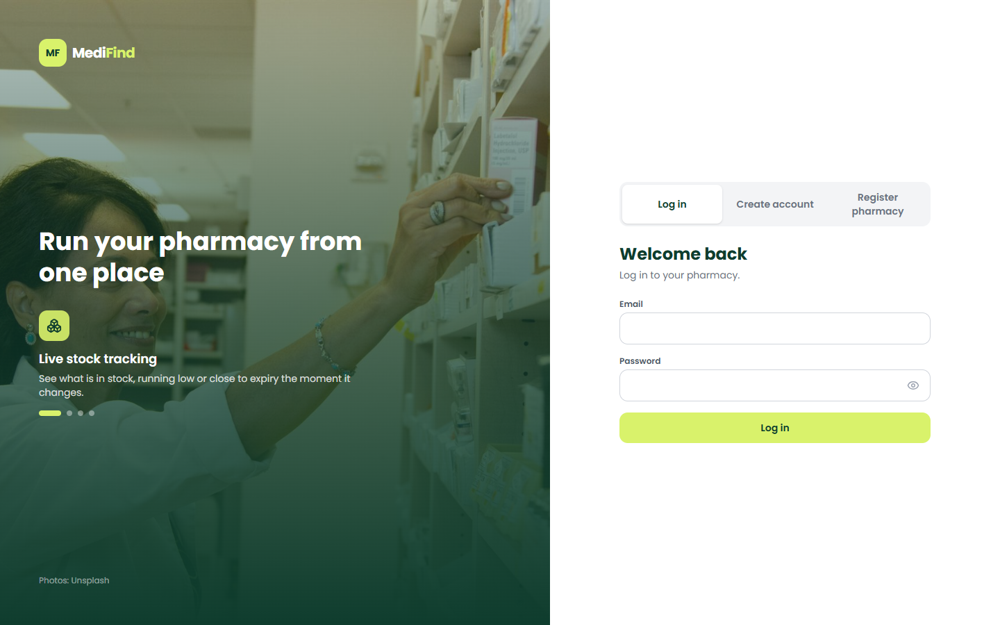

## The problem

Small independent pharmacies lose money and time managing stock by hand. Medicines run out before anyone notices, slow-moving stock expires on the shelf, and finding a supplier for an urgent item means phoning around. In 2025 Zimbabwe's national medicines distributor wrote off about US$3 million of expired stock, and its own assessment found that nearly 80% of it could have been prevented with better systems ([source](https://allafrica.com/stories/202605010167.html)).

MediFind gives a pharmacy one place to sell, track stock, and reorder. An AI assistant reads the stock and finds suppliers, and the pharmacist makes every decision.

## Features

- **Till (New Sale):** a fast point-of-sale screen. Each sale updates stock, the order and the payment, and records which staff member made it. **Print receipt** prints a receipt with the pharmacy's name, address, contact details and licence number, sized for an 80 mm till printer (it also prints on A4 or saves as a PDF).
- **Customers on New Sale:** pick an existing customer from the suggestions, or type a new one. A phone number or email that is already saved for someone with a different name is never matched silently: the till operator is asked whether the sale is for that person or whether to use a different number. Phone numbers match however they are written (0772 222 222 or +263772222222), and the customer search finds people by phone too.
- **Type the sale:** New Sale has one search box. Type a medicine name to find it, or the whole sale, e.g. "2 paracetamol and 1 amoxicillin for Tendai", and press Enter. MediFind finds each medicine in the pharmacy's own products and lists every line for the till operator to check, change or skip before it goes into the sale. The AI only reads the note: it can only pick from the pharmacy's own product list, and the customer's name and any phone number are removed before the note is sent. Without the AI, built-in rules read the note.
- **Separate pharmacies:** many pharmacies can use MediFind, and each one only ever sees its own products, sales, customers, payments, staff, settings and private suppliers. The server enforces this on every request.
- **Inventory:** add, edit and search products, each with a selling price and a cost price (what the pharmacy pays for one). Each one is marked In Stock, Low Stock or Out of Stock, using the low-stock level the pharmacy sets on the Settings page. Stock close to expiry is marked Expires soon, and stock past its date is marked Expired.
- **Dashboard:** orders, revenue and profit, customers, low stock, monthly sales and top sellers. The dashboard and Sales page refresh on their own every 30 seconds, so new sales show without reloading.
- **Profit from cost prices:** profit is the selling price minus the cost price of each medicine sold. Each sale keeps what its medicines cost at the time, so a later change to a cost price does not rewrite past profit; older sales use today's cost price. Marking a restock order received sets the product's cost price to what was paid per unit. Sales of a medicine with no cost price are left out of profit, and the pages say how many. Till operators do not see cost prices.
- **Weekly summary:** part of Pill's results when Generate Insights is pressed. The last 7 days in plain words: sales compared with the week before, profit, best sellers, busiest day, sales by staff member, and what is running out, low or expiring. Buttons send it by WhatsApp or email to the pharmacy's own number and address from Settings, or copy it. Every figure is counted by fixed rules, not AI.
- **Welcome tour:** the first time someone logs in, a short step-by-step tour opens each page and highlights it in the sidebar (one version for admins, a shorter one for till operators). "Show me around" on Help & Support replays it.
- **Orders, sales, customers and payments:** searchable lists with filters and pagination. On a narrow screen, wide tables slide left and right so every column can be reached.
- **Export:** download products, orders, sales, customers and payments as CSV, Excel (.xlsx) or PDF. The file holds every row that matches the search and filters on screen, not just the current page.
- **Settings (admin):** the pharmacy's profile, the stock rules (low-stock level and how many days before expiry to warn), and changing your password.
- **Pill, the stock assistant:** lists what will run out first, from how fast each item sold over the last 4 weeks ("Paracetamol: 12 left, sells about 1 a day, so it runs out in about 12 days"), with how much to order for 30 days and a **Find suppliers** button. Low-stock items that are not selling come after, then stock close to expiry. The list and every number in it are worked out by MediFind; the AI writes only the short summary at the top.
- **AI supplier search:** type "I urgently need 200 insulin". The AI pulls out the medicine, quantity and urgency, and MediFind ranks suppliers by delivery time (when urgent) or price.
- **Restock orders:** order from a supplier. Marking the order received adds the stock to inventory, exactly once, and updates the product's cost price.
- **Staff roles and approval:**
  - Admins see everything.
  - Till operators see only New Sale, product lookup, customers and their own sales.
  - Staff join a pharmacy with that pharmacy's join code, then wait until its admin approves them.
  - "Register pharmacy" asks to open a new pharmacy. A MediFind platform owner checks and approves it, which creates the pharmacy with that person as its admin. Platform owners see the registration details only, never another pharmacy's data.
  - The server enforces these rules, not just the screen.

## Screenshots

| | |
|---|---|
| 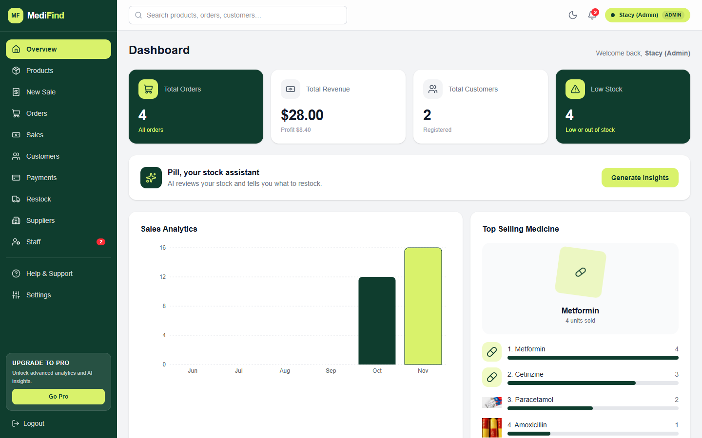 Dashboard | 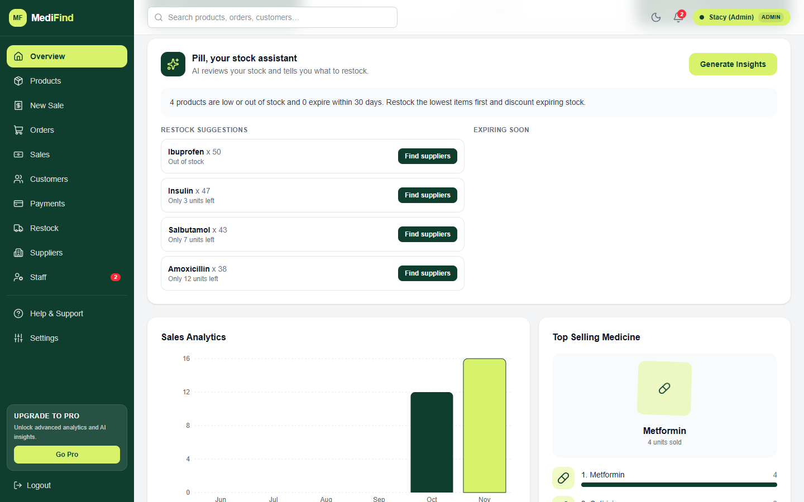 Pill stock insights |
| 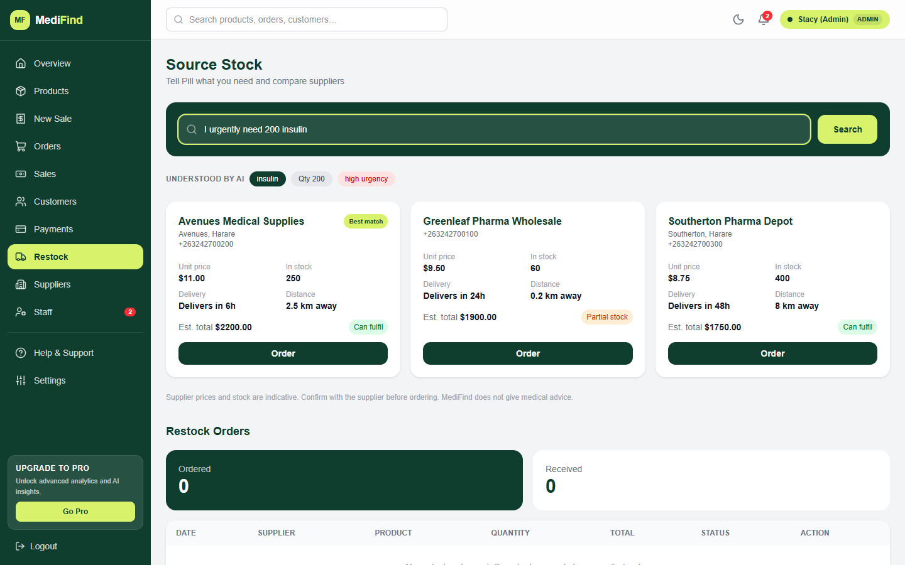 AI supplier search | 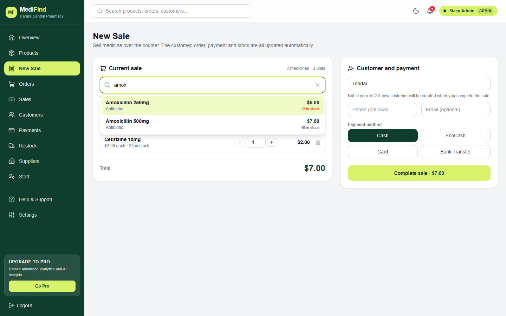 Till (New Sale) |
| 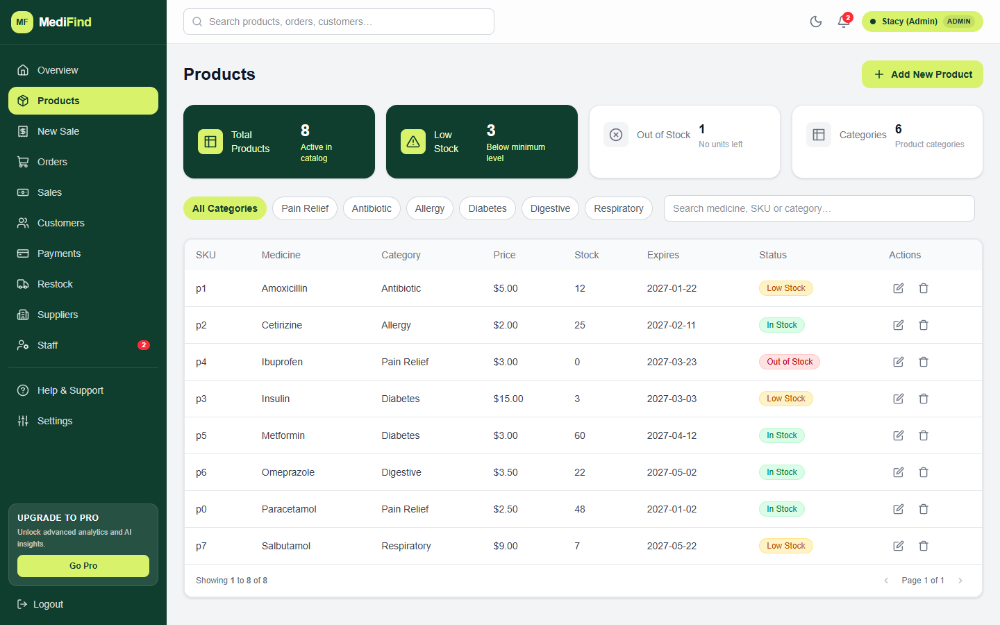 Inventory | 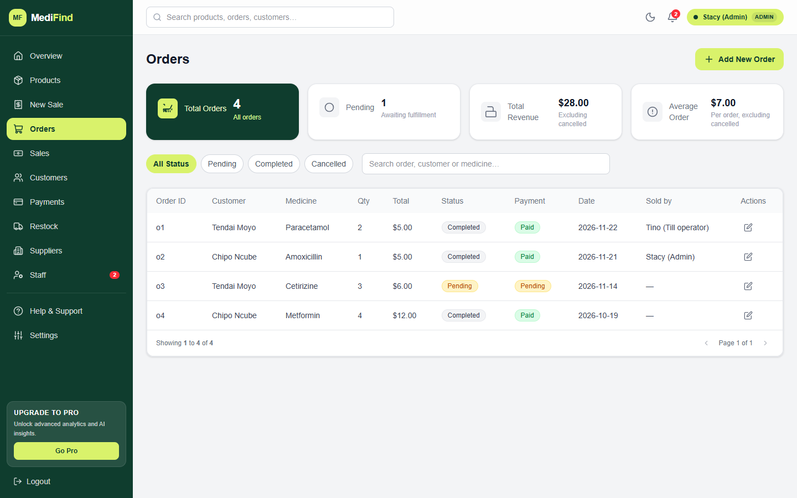 Orders with "Sold by" |
| 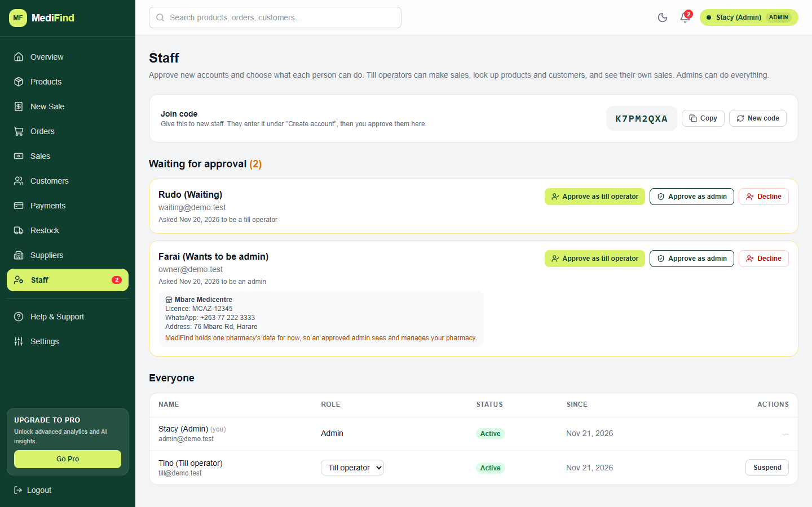 Staff and approvals | 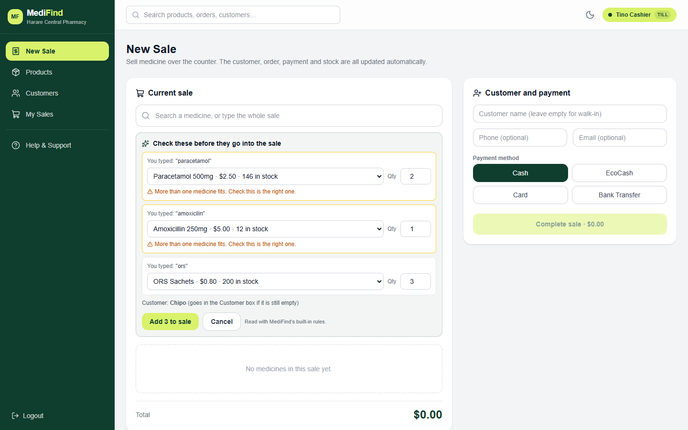 Till operator typing a whole sale |
| 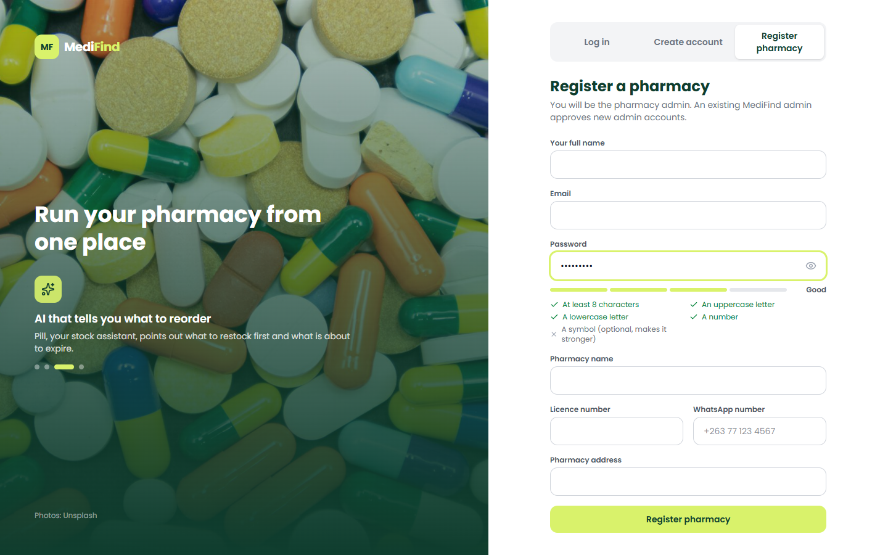 Register a pharmacy | 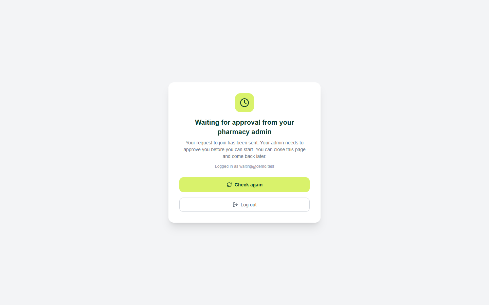 Waiting for approval |

The screenshots use sample data.

## Tech stack

| Layer | Technology | Hosting |
|---|---|---|
| Frontend | React 19, Vite, Tailwind CSS 4, React Router, Recharts, lucide-react | Vercel |
| Backend | Node.js, Express 5, Helmet, rate limiting on AI routes | Render |
| Database and login | Supabase (PostgreSQL + Supabase Auth), row-level security on | Supabase |
| AI | Google Gemini API (`@google/generative-ai`), called from the backend only | Google |

## Project structure

```
MEDIFIND/
  frontend/            React app
    src/pages/         one file per screen
    src/components/    layout, access screens
    src/lib/           API client, Supabase login client, access rules
    public/onboarding/ login page photos (see CREDITS.txt)
  backend/             Express API
    routes/            one file per area (products, orders, pos, ai, sourcing, staff...)
    lib/               auth and roles, Gemini helper, rate limiter, stock helpers,
                       sale-note reader, customer matching, stock-out forecast (used by Pill), weekly summary
    supabase/          schema, seed data and migration SQL
  docs/                AI integration, ethics statement, API notes, screenshots
```

## Run it locally

**You need:** Node.js 18 or newer, a free Supabase project, and a Gemini API key from Google AI Studio (https://aistudio.google.com/apikey).

### 1. Get the code and install

```
git clone https://github.com/wekwamutamba-lab/MEDIFIND.git
cd MEDIFIND/backend
npm install
cd ../frontend
npm install
```

### 2. Set up the database

In the Supabase dashboard, open **SQL Editor**, then run these files from `backend/supabase/` in this order:

1. `schema.sql`: all tables, the stock view and row-level security
2. `seed_1_pharmacies_customers.sql` to `seed_5_suppliers.sql`: sample data (optional)

You run one more file, `migration_pharmacies.sql`, in step 6.

Under **Authentication > Providers**, turn on Email. For local testing you can turn off "Confirm email".

### 3. Create `backend/.env`

```
PORT=5000
CORS_ORIGIN=http://localhost:5173
SUPABASE_URL=https://YOUR-PROJECT.supabase.co
SUPABASE_SERVICE_ROLE_KEY=your-service-role-key
GEMINI_API_KEY=your-gemini-key
GEMINI_MODEL=gemini-3.8-flash
```

Optional settings:

- `APP_TIMEZONE`: defaults to `Africa/Harare`.
- `AI_LIMIT_PER_MINUTE`: defaults to 10.
- `AI_LIMIT_PER_DAY`: defaults to 200.
- `AI_LIMIT_GLOBAL_PER_MINUTE`: defaults to 60.

### 4. Create `frontend/.env`

```
VITE_API_URL=http://localhost:5000/api
VITE_SUPABASE_URL=https://YOUR-PROJECT.supabase.co
VITE_SUPABASE_ANON_KEY=your-anon-key
```

Find both keys in Supabase under **Project Settings > API**. The `service_role` key bypasses all database security, so it goes only in `backend/.env` and never in the frontend.

### 5. Start both apps (two terminals)

```
cd backend
npm run dev        # API on http://localhost:5000
```

```
cd frontend
npm run dev        # app on http://localhost:5173
```

### 6. Make yourself the first admin

1. Open http://localhost:5173 and use **Register pharmacy** to create your account. It will say it is waiting for approval.
2. In the Supabase SQL Editor, approve yourself once (put your email in the last line):

   ```sql
   insert into staff (user_id, email, full_name, role, status, requested_role)
   select id, email, coalesce(raw_user_meta_data->>'full_name', email), 'admin', 'active', 'admin'
   from auth.users where lower(email) = lower('you@example.com')
   on conflict (user_id) do update set role = 'admin', status = 'active';
   ```

3. Then run `backend/supabase/migration_pharmacies.sql` once. It puts you and any sample data into one pharmacy, and makes you a platform owner (you approve new pharmacies).
4. Click **Check again**. From now on you approve your staff on the **Staff** page, and new pharmacy registrations appear there too.
5. Give your till operators the join code from the Staff page. They sign up with **Create account**.

**Never commit `.env` files.** If a key is ever pushed to GitHub, rotate it straight away: Supabase under Project Settings > API, Google in AI Studio.

## Deploying

- **Backend (Render):** create a Web Service from `backend/` with build command `npm install` and start command `npm start`. Add the backend variables above, and set `CORS_ORIGIN` to your Vercel URL.
- **Frontend (Vercel):** import `frontend/` as a Vite project. Add the three `VITE_` variables, with `VITE_API_URL` pointing to your Render URL plus `/api`.
- **Database:** an existing database also needs `backend/supabase/migration_roles.sql`, `migration_settings.sql`, `migration_pharmacies.sql`, `migration_order_names.sql` and `migration_cost_price.sql` run once, in that order, before the code that uses them is deployed. All five are safe to run more than once.

## Documentation

- [AI integration](docs/AI_INTEGRATION.md): which API, what it does, its limitations
- [Ethical and responsible AI statement](docs/ETHICS.md): privacy, bias, transparency
- [API reference](docs/API_CONTRACT.md): endpoints and who can use them

## Known limitations

- Supplier catalogue data is entered in MediFind. It is not a live feed from suppliers.
- Each staff account belongs to one pharmacy. One login cannot yet switch between several branches.
- Profit is only as good as the cost prices entered. Sales of medicines with no cost price are left out of it.
- A sale on one till shows on another only after that screen reloads its data.
- Pill's forecast assumes each item keeps selling at the rate of the last 4 weeks. It does not know about seasons, outbreaks or one-off bulk sales.
- The weekly summary is sent by pressing a button. It is not yet sent automatically.

## Roadmap (not built yet)

Only the features listed above are built. Staff roles, approval, separate pharmacies, printed receipts, typed sales, the stock-out forecast in Pill and the weekly summary are the parts of the product roadmap that have shipped.

**Next: a smoother till**

- Barcode scanning with a USB scanner or the phone camera
- Held sales, refunds and returns
- Shift open and close with a cash-up for each till operator
- Receipts sent by WhatsApp
- The weekly summary sent automatically every Monday (this needs a WhatsApp Business or email-sending account)
- Batch tracking that sells the earliest-expiring batch first
- Two currencies (USD and local) at a rate the admin sets
- Offline mode that queues sales and syncs when the connection returns
- Live stock updates on every till without refreshing
- A controlled-medicines log, after checking the exact requirements with the regulator

**Later: more AI**

- Ask your pharmacy anything ("What sold best last week?"), with the AI choosing from fixed reports, never writing database queries
- Photograph a supplier invoice and let the AI add the stock
- Anomaly alerts for unusual discounts, voids or stock that does not match
- Expiry action plans: discount, return to supplier, or transfer
- Alternatives from the pharmacy's own stock when an item runs out, for the pharmacist to approve

**Later: branches**, so one owner can manage several pharmacies from one login.

A drug-interaction checker will not be added unless it is built on a vetted medical database.
