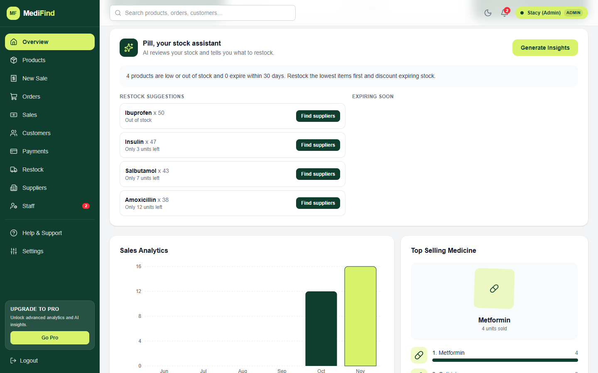
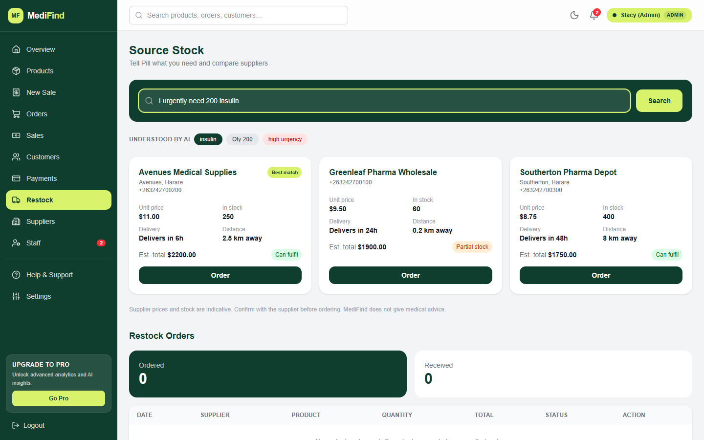

# AI Integration

## Which API

MediFind uses the **Google Gemini API** through Google's official Node.js library, `@google/generative-ai`.

- **Model:** set by the `GEMINI_MODEL` environment variable. The current default is `gemini-3.8-flash`, a fast, low-cost model. It can be changed on Render without a code change.
- **Where it runs:** every AI call is made by the Express backend, in `backend/lib/gemini.js`. The browser never sees the API key and never talks to Google directly.
- **Output format:** each call sends a system instruction that asks for **JSON only**. The backend parses the JSON and checks its shape before using it.

## What the AI does

### 1. Pill, the stock assistant (`POST /api/insights`)

Pill tells the pharmacist what to reorder and what is about to expire.

1. The backend selects the products that are low or out of stock and the products close to expiry, using the low-stock level and expiry warning set on the Settings page (20 units and 30 days by default).
2. It sends Gemini the **name, category, quantity and expiry date** of up to 15 items in each group. Nothing else is sent.
3. Gemini returns:
   ```json
   { "summary": "...", "restock": [{ "product": "...", "suggestedQty": 50, "reason": "..." }],
     "expiring": [{ "product": "...", "expiry_date": "2026-12-01" }] }
   ```
4. The dashboard shows the summary and the lists. Each restock suggestion has a **Find suppliers** button that runs the supplier search below.



### 2. Supplier search (`POST /api/find`)

The pharmacist types what they need in their own words, for example "I urgently need 200 insulin".

1. The backend sends that text to Gemini with an instruction to return `{ "medicine": string, "quantity": number, "urgency": "low" | "medium" | "high" }`.
2. MediFind searches the supplier catalogue in the database for that medicine, keeping only suppliers who have it in stock.
3. **The ranking is done by fixed rules, not by the AI.** When urgency is high, the fastest delivery comes first. Otherwise, the lowest price comes first.
4. The screen shows **what the AI understood** (medicine, quantity, urgency) above the results. Each supplier card shows unit price, stock, delivery time, distance, estimated total, and whether the supplier can supply the full quantity.
5. The pharmacist chooses a supplier and confirms the order. Nothing is ordered automatically.



### 3. Type the sale (`POST /api/pos/note`)

On New Sale, the till operator can type what the customer wants, for example "2 paracetamol and 1 amoxicillin for Tendai", instead of searching for each item.

1. The backend takes the customer's name off the note ("for Tendai", "customer: Tendai"). It also removes any phone number, and a trailing "for ..." that is not a medicine. That copy of the note, and the **names** of the pharmacy's own products, are sent to Gemini. Nothing else is sent.
2. Gemini returns `{ "lines": [{ "said": string, "product": string | null, "quantity": number }] }`. The prompt tells it to copy product names exactly from the list, and to return `null` instead of guessing between strengths or forms.
3. **Every name Gemini returns is checked against the pharmacy's product list.** A name that is not in the list is thrown away, so the AI cannot add a product the pharmacy does not stock.
4. The screen lists each line: what was typed, the medicine found (with price and stock), and the quantity. Lines are marked for checking when nothing was found, when more than one product fits (for example two strengths), or when the item is out of stock.
5. The till operator changes or skips lines and presses **Add to sale**. Nothing is sold, and no stock changes, until they press **Complete sale** as usual.

```
Till operator types a note
  -> customer name and phone numbers removed
  -> Gemini splits it into medicines from the product list   (or built-in rules if Gemini fails)
  -> every name checked against the pharmacy's products
  -> till operator checks each line, then adds them to the sale
  -> Complete sale (unchanged)
```

### Not AI: the stock-out forecast and the weekly summary

These two features use **plain arithmetic** on the pharmacy's own records. They were kept away from the AI on purpose, because their numbers must be exact and the same every time.

- **Stock-out forecast** (`GET /api/reports/forecast`, in `backend/lib/forecast.js`): units sold in the last 28 days divided by 28 gives units a day. Units in stock divided by units a day gives days left. The suggested order covers 30 days of sales. A pharmacy that started selling less than 28 days ago is measured over the days since its first sale (at least 7).
- **Weekly summary** (`GET /api/reports/weekly`, in `backend/lib/weekly.js`): totals for the last 7 days and the 7 days before, best sellers, busiest day, sales by staff member, and the stock counts. The message is written from a fixed template.

```
Pharmacist types a request
  -> Gemini extracts medicine, quantity, urgency   (or keyword rules if Gemini fails)
  -> search the supplier catalogue in Supabase
  -> rank: urgent = fastest delivery, otherwise = cheapest
  -> pharmacist checks and confirms the order
  -> "Mark received" adds the stock to inventory, exactly once
```

## When the AI is not available

The app keeps working without Gemini, for example when the key is missing, the quota has run out, the network fails, or the reply is not valid JSON:

- **Supplier search** falls back to simple parsing: the first number in the text is the quantity, words such as "urgent" or "asap" set high urgency, and the remaining keywords are searched.
- **Pill** falls back to a rule-based summary that lists the lowest-stock items first, with a suggested quantity that brings each one back up to about 50 units.
- **Type the sale** falls back to built-in rules: the note is split at commas and "and", quantities such as "2", "2x", "x2" or "two" are read, and each medicine is matched to the closest product name (small typos are allowed). The screen says which way the note was read.

Each failure is logged on the server.

## Cost and abuse controls

- **Rate limits:** the three AI endpoints are limited to 10 requests a minute and 200 a day per user, and 60 a minute across all users. The limits can be changed with environment variables and are explained in `backend/lib/rateLimit.js`.
- **Login and approval:** only logged-in, approved staff can reach the AI endpoints.
- **Small requests:** Pill sends at most 30 short items, and Type the sale sends one short note and the product names (at most 400), so each call costs a fraction of a cent.

## Limitations

- **Unusual names:** the AI can misread a misspelled or unusual medicine name, or a local brand name. This is why the screen shows what it understood, so the pharmacist can check it and search again.
- **Name matching only:** search matches the medicine name, not the active ingredient, so a brand name and its generic are not linked yet. In Type the sale, the AI may match a brand name to the generic in the pharmacy's list. The till operator sees which product was chosen and can change it.
- **Supplier data:** supplier prices and stock come from the catalogue held in MediFind, not from live supplier systems. The app shows a disclaimer saying they are indicative.
- **Free tier:** the free Gemini tier has rate limits, and Google uses free-tier data to improve its products. A live deployment with real pharmacies should use the paid tier. See [ETHICS.md](ETHICS.md).
- **Model changes:** model names change over time, which is why the model is a setting.
- **No medical advice:** the AI never gives medical advice, diagnoses or dosage guidance, and every prompt forbids it.

## Supplier tables

The supplier tables (`suppliers`, `supplier_products`, `restock_orders`) are part of `backend/supabase/schema.sql`. Sample suppliers are in `seed_5_suppliers.sql`.
